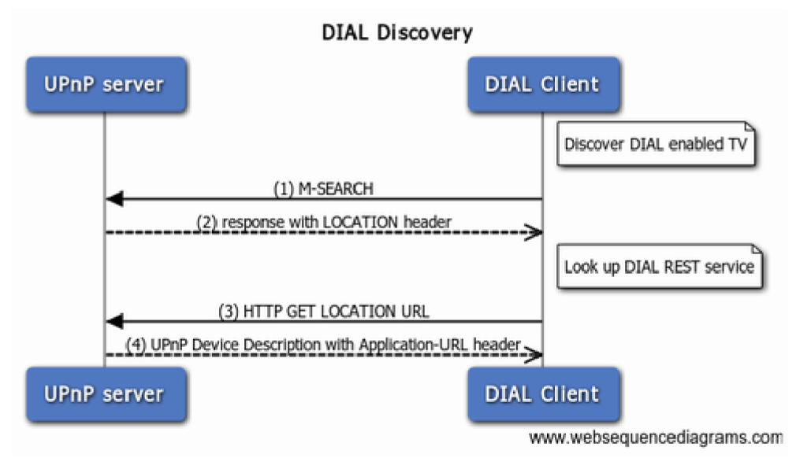

# DIAL Service Discovery

**DIAL**--for **DI**scovery **A**nd **L**aunch-- is a simple protocol that second-screen devices can use to discover and launch apps on first-screen devices. (Sources: DIAL)
- Removes the pain of having to launch the required app on the first-screen before interacting with it from their second-screen.
- Only requirement is that both first and second-screens are connected to the same home network. (Sources: NCSC)

A DIAL client that wishes to discover DIAL servers SHALL send an **M-SEARCH request** over UDP to the IPv4 multicast address 239.255.255.250 and UDP port 1900 including the Search Target header (`ST`)

`urn:dial-multiscreen-org:service:dial:1`

(Sources: Netflix, *DIAL protocol specification Version 1.6.4*)

## M-SEARCH request
The **"M-"** prefix indicates the request is a "mandatory" request within the HTTP Extension Framework.

### MAN
Defines the scope of extension.

### MX
Seconds to delay response

### `urn` (Uniform Resource Name)
Identify the specific type of device or service a client is searching for on a local network

